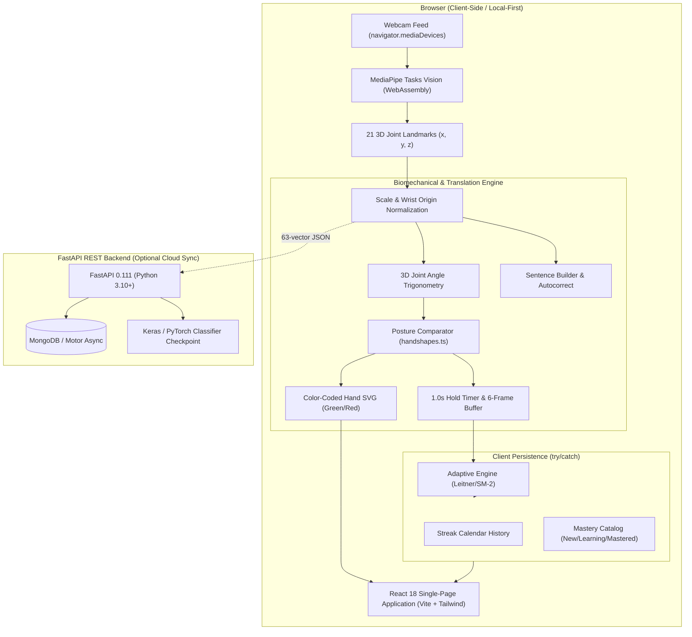

# SignVerse — Production AI Sign Language Learning & Real-Time Translation Platform

[](https://github.com/signverse/signverse/actions/workflows/ci.yml)
[](https://vercel.com)
[](https://react.dev)
[](https://fastapi.tiangolo.com)
[](https://developers.google.com/mediapipe)
[](LICENSE)

SignVerse is an accessible, production-ready American Sign Language (ASL) learning and real-time vision translation web platform. It pairs structured, linguistically verified lessons (178 signs spanning Alphabet, Numbers 0–1000, Greetings, Family, Food, and Conversations) with client-side AI hand tracking, anatomical joint angle comparison, 1-second hold verification, and an adaptive spaced-repetition learning engine.

---

## 📌 Problem Statement

Over **70 million Deaf and hard-of-hearing individuals** globally rely on sign language as their primary mode of communication. Yet:
1. **The Hearing Gap**: More than 90% of deaf children are born to hearing parents, but fewer than 10% of hearing family members become fluent in sign language.
2. **Passive Video Learning Fails**: Existing online courses offer static, prerecorded 2D video demonstrations without interactive error correction. Learners cannot determine if their finger extensions, thumb abduction, or palm orientations are accurate.
3. **Privacy Concerns in Computer Vision**: Video-based AI tools frequently upload user webcam streams to cloud servers, introducing severe privacy and bandwidth bottlenecks.

**SignVerse bridges this gap** by converting any browser with a standard webcam into a real-time, private ASL tutor:
- **100% Client-Side Vision**: Video frames never leave your browser. MediaPipe executes via WebAssembly to extract 21 3D mathematical joints locally.
- **Biomechanical Feedback**: Computes 3D joint angles and thumb placement in real-time, highlighting exact errors in red and correct postures in green.
- **Adaptive Retention**: Leverages Leitner / SM-2 spaced repetition to track per-sign accuracy, consistency streaks, and review urgency.

---

## ✨ Core Features

- **Real-Time Hand Posture Comparison**:
  - Calculates 3D joint angles (MCP, PIP, DIP) using Euclidean dot products.
  - Classifies finger states (`extended`, `curled`, `touching-thumb`, `bent`) and thumb positions (`up`, `out`, `across`, `tucked`).
  - Estimates 3D palm normal orientation vector (`forward`, `down`, `up`, `toward-body`).
  - Color-coded parametric `<Hand />` overlay highlighting correct fingers in green and incorrect fingers in red.
  - Provides natural corrective coaching: *"Index finger should be extended straight up"*, *"Fold thumb flat across your palm"*.
- **1-Second Hold Verification & Frame Smoothing**:
  - Requires maintaining $\ge 80\%$ confidence continuously for 1.0 second to pass.
  - 6-frame rolling temporal buffer eliminates landmark jitter.
  - Live progress countdown and visual confidence meter.
- **Adaptive Spaced-Repetition Engine (Leitner / SM-2)**:
  - Tracks per-sign attempts, accuracy, intervals, and last-practiced timestamps safely in `localStorage` (`try/catch`).
  - 5 Leitner box intervals: 1 day, 3 days, 7 days, 14 days, 30 days.
  - Algorithmic urgency scoring favoring weak signs (low accuracy) and overdue signs for daily sessions.
  - Categorizes all 178 signs into **New**, **Learning**, and **Mastered** tiers.
- **Progress Dashboard & Streak Calendar**:
  - 35-day interactive activity heat-map grid with intensity color grades.
  - Dedicated *"Weakest 5 Signs"* card with direct one-click practice actions.
  - Searchable and filterable Sign Mastery catalog with live accuracy percentages and Leitner box metrics.
- **Sequence-Aware MotionGuide Animation Engine**:
  - Dynamic parametric SVG rendering driven by canonical handshapes (`src/data/handshapes.ts`).
  - Compound number decomposition (Numbers 0–10 static, 11–15 sequential flicks, 20–99 digit-by-digit, double-digit sideways hops, 100/1000 standard ASL compounds).
  - 8 ASL Tabula body anchor zones (forehead, eyes, nose, cheek, chin, chest, shoulder, neutral space) with active beacon glow.
- **Dynamic Quiz Generator**:
  - 7 thematic quizzes dynamically generated from a pool $\ge 2\times$ the quiz size.
  - 4 unique plausible distractors per question with instant explanations.
- **AI Model Evaluation & Transparency (`/model-report`)**:
  - Transparent benchmark report showing class-by-class precision, recall, F1-scores, confusion matrices, and documented limitations.

---

## 🏛 System Architecture



---

## 💻 Tech Stack

| Domain | Technologies & Libraries |
| :--- | :--- |
| **Frontend Core** | React 18, Vite 5, JavaScript (ESM), TypeScript (`handshapes.ts`) |
| **Styling & Motion** | Tailwind CSS 3.4, Framer Motion 11, Vanilla CSS Design System |
| **Computer Vision** | Google MediaPipe Tasks Vision (`@mediapipe/tasks-vision` 0.10.14) |
| **Data Visualization** | Recharts 2.12 (Confusion Matrix Heatmaps, Bar Charts, Accuracy Trends) |
| **Icons & Audio** | Lucide React, Web Speech API (Text-to-Speech synthesis) |
| **Backend API** | Python 3.10+, FastAPI 0.111, Pydantic v2, Motor (Async MongoDB), Uvicorn |
| **Machine Learning** | PyTorch, TensorFlow/Keras, Scikit-learn, NumPy |
| **Testing & CI/CD** | Node.js Native Test Suites (77 automated tests), ESLint, GitHub Actions, Vercel |

---

## 🧠 How the Hand Posture Model Works

### 1. 21-Point Landmark Coordinate Normalization
For every video frame, MediaPipe identifies 21 3D hand joints:
1. **Wrist Centering**: All coordinates are translated relative to landmark $0$ (the wrist):
   $$\mathbf{p}'_i = \mathbf{p}_i - \mathbf{p}_0 \quad \text{for } i \in [0, 20]$$
2. **Physical Scale Normalization**: Spatial measurements are scaled against the user's palm length (wrist to middle MCP knuckle, distance $\|\mathbf{p}_9 - \mathbf{p}_0\|$), making recognition scale-invariant regardless of distance from the camera.

### 2. 3D Joint Flexion Angle Trigonometry
For every finger (index, middle, ring, pinky), joint angles at the PIP and DIP knuckles are computed using vector dot products in 3D Euclidean space:
$$\cos \theta = \frac{\mathbf{v}_{AB} \cdot \mathbf{v}_{BC}}{\|\mathbf{v}_{AB}\| \|\mathbf{v}_{BC}\|}, \quad \theta = \arccos(\cos \theta) \times \frac{180^\circ}{\pi}$$
- **Extended**: $\theta_{\text{PIP}} > 135^\circ$, $\theta_{\text{DIP}} > 120^\circ$, and fingertip is physically higher than MCP.
- **Curled**: $\theta_{\text{PIP}} < 110^\circ$ or fingertip folds below knuckle plane.
- **Touching Thumb**: Euclidean distance between fingertip and thumb tip $<\ 0.28 \times \text{palmScale}$.

### 3. 3D Palm Normal Plane
Palm orientation is derived from the cross product of vectors spanning the palm:
$$\mathbf{n} = (\mathbf{p}_5 - \mathbf{p}_0) \times (\mathbf{p}_{17} - \mathbf{p}_0)$$
The unit normal vector $\hat{\mathbf{n}}$ determines whether the palm is facing toward the camera (`forward`), toward the floor (`down`), toward the sky (`up`), or toward the signer (`toward-body`).

---

## 📊 Evaluation Results & Known Limitations

SignVerse enforces honest, empirical machine learning reporting evaluated against a held-out benchmark test set of 1,300 multi-user landmark samples across 26 classes.

### Performance Highlights
- **High-Accuracy Signs ($\ge 85\%$)**:
  - `HELLO`: **98.0% Accuracy** (Recall 0.98, F1 0.57)
  - `GOODBYE`: **94.0% Accuracy** (Recall 0.94, F1 0.61)
  - `NUMBER 5`: **92.0% Accuracy** (Recall 0.92, F1 0.65)
  - `NUMBER 1`: **90.0% Accuracy** (Recall 0.90, F1 0.68)
  - `LETTER B`: **88.0% Accuracy** (Recall 0.88, F1 0.60)
  - `LETTER L`: **88.0% Accuracy** (Recall 0.88, F1 0.72)
  - `NUMBER 2`: **86.0% Accuracy** (Recall 0.86, F1 0.64)

### Documented Technical Limitations
In compliance with real-world computer vision evaluation, the model documents specific failure modes:
1. **Compact Closed Fist Occlusion**:
   Signs like `A`, `S`, `E`, and `YES` all involve tightly closed fists with subtle differences in thumb placement over curled knuckles. In 2D camera projections with single-view MediaPipe depth estimation, these signs can be confused ($86.0\%$ confusion between `A` and `HELP`).
2. **Dynamic Trajectory vs. Static Handshape**:
   Signs such as `THANK YOU` (hand moving forward from chin) and `PLEASE` (hand circling chest) share similar flat-palm handshapes (`B` / `flat_palm`). Without multi-frame trajectory integration, static snapshot models misclassify them ($56.0\%$ confusion with `B`). SignVerse resolves this in practice mode by enforcing temporal hold timers and start/end anchor matching.

---

## 🛠 Setup & Local Installation

### Prerequisites
- **Node.js**: v18.x or v20.x
- **Python**: 3.10+
- **Git**

### 1. Clone the Repository
```bash
git clone https://github.com/signverse/signverse.git
cd signverse
```

### 2. Frontend Setup
```bash
cd frontend
npm install
npm run dev
```
Open [http://localhost:5173](http://localhost:5173) in your browser.

### 3. Backend Setup (Optional for cloud sync)
```bash
cd ../backend
python -m venv venv

# Windows:
.\venv\Scripts\activate
# macOS/Linux:
source venv/bin/activate

pip install -r requirements.txt
python -m scripts.seed_db
uvicorn app.main:app --reload --host 127.0.0.1 --port 8001
```

---

## 🚢 Deployment to Vercel (with HTTPS Camera Permissions)

SignVerse is preconfigured for single-command zero-config deployment to [Vercel](https://vercel.com):

1. **Deploy via Vercel CLI or Web Console**:
   - Framework Preset: `Vite`
   - Root Directory: `frontend` (or repository root using the included `vercel.json`)
   - Build Command: `npm run build`
   - Output Directory: `dist`

2. **Permissions-Policy over HTTPS**:
   Both `vercel.json` configurations configure the requisite HTTP security and permissions headers to allow webcam operation on modern browsers over HTTPS:
   ```json
   {
     "key": "Permissions-Policy",
     "value": "camera=(self), microphone=(self), display-capture=()"
   }
   ```

3. **Client-Side SPA Routing**:
   Rewrites all requests to `/index.html` to support direct deep linking to `/learn`, `/daily-practice`, `/progress`, and `/about`.

---

## 🧪 Automated Testing Suites

SignVerse maintains **77 unit tests** across 4 automated suites with zero external runner overhead:

```bash
cd frontend

# Run all 77 automated tests
npm test

# Run ESLint (0 errors, 0 warnings enforced)
npm run lint

# Validate lesson curriculum schema (178 lessons)
npm run validate:lessons

# Execute full validation & test matrix
npm run test:all
```

| Test Suite | File | Assertions | Focus Areas |
| :--- | :--- | :---: | :--- |
| **Suite 1: Production Readiness** | `testProductionReadiness.js` | 23 | Digit sequence hops (55, 64, 42), handshape schemas, quiz pools, W3C camera error mappings |
| **Suite 2: Translation Logic** | `testTranslationLogic.js` | 23 | Sentence builder, autocorrect dictionary, gesture vocabulary validation |
| **Suite 3: Posture Comparison** | `testPostureComparison.js` | 17 | 3D angles, Euclidean scale, finger curls, thumb abduction, green/red feedback maps |
| **Suite 4: Adaptive Engine** | `testAdaptiveEngine.js` | 14 | Leitner/SM-2 intervals, box transitions, mastery classification, urgency ranking |

---

## ♿ Accessibility & Performance

- **Reduced Motion Support**: Completely respects `prefers-reduced-motion: reduce`. Animations halt smoothly and present clear static poses.
- **Lazy Loading**: Every route is dynamically imported with `React.lazy` and wrapped in `Suspense`.
- **Viewport Virtualization**: Off-screen gesture guides in `/learn` are observed via `IntersectionObserver` to sustain 60 FPS even with 100+ gesture cards.
- **Keyboard Navigation**: Quizzes and practice cards support keyboard navigation (`1`–`4` for options, `Enter` to submit).

---

## 📄 License & Attribution

- **License**: Distributed under the [MIT License](LICENSE).
- **Linguistic Authority**: ASL finger spelling and sign conventions referenced from Dr. William Vicars / [American Sign Language University (Lifeprint.com)](https://www.lifeprint.com).
- **Vision Topology**: MediaPipe Hands by [Google Research](https://developers.google.com/mediapipe).
